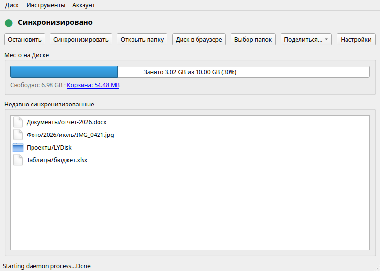
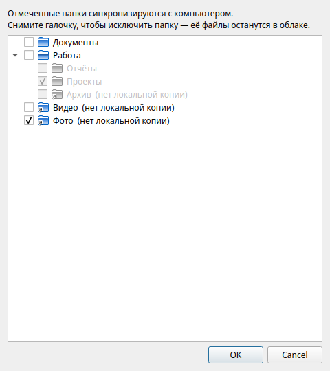
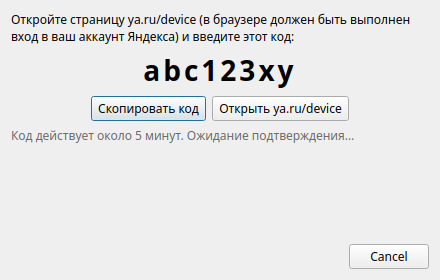
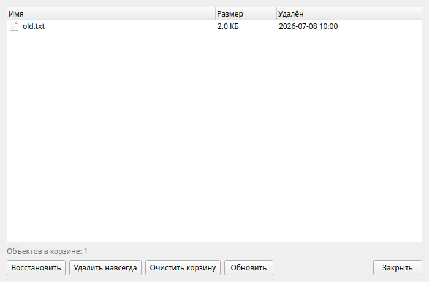
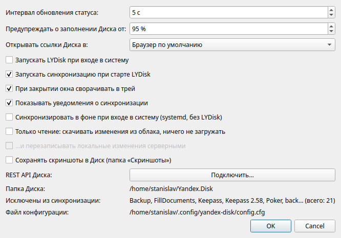

# LYDisk — Яндекс Диск с графическим интерфейсом для Linux

Официальный клиент Яндекс Диска для Linux — консольный
([документация](https://yandex.ru/support/yandex-360/customers/disk/desktop/linux/ru/)).
LYDisk — графическая оболочка над ним, дающая привычный по Windows опыт:

- **значок в системном трее** с цветовой индикацией: зелёный — синхронизировано,
  синий — идёт синхронизация, оранжевый — нет сети, красный — ошибка,
  серый — служба остановлена;
- окно со **статусом, квотой диска** (занято/свободно/корзина)
  и списком **последних синхронизированных файлов** (двойной клик — открыть);
- запуск/остановка службы синхронизации, принудительная синхронизация;
- **публичные ссылки**: правый клик по файлу в списке или кнопка «Поделиться…» —
  ссылка сразу копируется в буфер обмена; отмена публикации там же;
- **выборочная синхронизация** (кнопка «Выбор папок»): дерево папок Диска
  с галочками, как в Windows-клиенте. Снятая галочка добавляет папку в
  `exclude-dirs`, LYDisk предложит удалить её локальную копию (в облаке файлы
  остаются) и сам перезапустит синхронизацию. Уже исключённые папки показываются
  с пометкой «нет локальной копии» — их можно включить обратно;
- открытие папки Диска в файловом менеджере и веб-версии Диска в браузере;
- автозапуск при входе в систему (включается в настройках), сворачивание в трей;
- **вход в аккаунт прямо из окна** — по коду устройства (ya.ru/device), без
  терминала и без ввода пароля; смена аккаунта в меню «Аккаунт»;
- **уведомления** о завершении синхронизации, ошибках и потере соединения;
- **корзина** — кликабельная ссылка в блоке квоты и пункт меню;
- **режим «только чтение»** (`--read-only`, опционально `--overwrite`) в настройках;
- **меню Dolphin**: правый клик на файле в папке Диска → «Яндекс Диск →
  Скопировать публичную ссылку / Отменить публикацию» (ставится автоматически
  при первом запуске LYDisk);
- **фоновая синхронизация без GUI** — галочка в настройках создаёт
  systemd-юнит пользователя `yandex-disk.service`;
- **диагностика** (Инструменты → Диагностика): версия клиента, журнал
  синхронизации, перезапуск демона;
- **автоперезапуск при отказе дельта-загрузки**: если сервер Яндекса
  отклоняет загрузку изменённой части файла (ошибка 500, а клиент повторяет
  её бесконечно или молча бросает), LYDisk перезапускает демон, и тот
  загружает файлы целиком
  (не чаще раза в 15 минут; отключается в настройках);
- **реестр публичных ссылок** (Инструменты → Публичные ссылки): всё, что
  публиковали через LYDisk — копирование, открытие, отмена публикации;
- **drag&drop**: перетащите файл из папки Диска на окно LYDisk — публичная
  ссылка окажется в буфере обмена;
- **предупреждение о месте**: уведомление, когда Диск заполнен на 95%
  (порог настраивается);
- **скриншоты в Диск**: галочка в настройках переключает Spectacle на
  сохранение снимков экрана в папку Диска «Скриншоты» (при выключении
  возвращается прежняя папка);
- **выбор браузера**: настройка «Открывать ссылки Диска в:» — веб-версия Диска,
  корзина и страница входа открываются в выбранном браузере (находит и
  flatpak-браузеры), а не в системном по умолчанию. Локальные файлы
  открываются как обычно;
- **REST API Диска** (опционально, Настройки → «REST API Диска: Подключить…»):
  после одноразовой регистрации приложения на oauth.yandex.ru открываются:
  - **корзина** (Инструменты → Корзина…) — просмотр, восстановление,
    удаление навсегда и полная очистка;
  - **настоящий список публичных ссылок** — всё опубликованное на Диске
    с сервера, а не только локальный реестр LYDisk.
  Токен хранится в `~/.config/LYDisk/api.json` (права 0600) и обновляется
  автоматически. Синхронизация от API не зависит.

## Скриншоты

| Главное окно | Выбор папок |
|---|---|
|  |  |

| Вход по коду | Корзина (API) | Настройки |
|---|---|---|
|  |  |  |

## Установка (готовый пакет)

Скачайте deb из [релизов](../../releases) и выполните:

```bash
sudo apt install ./lydisk_1.1.1_all.deb          # GUI + репозиторий Яндекса
sudo apt update && sudo apt install yandex-disk  # консольный клиент
```

## Требования

- Python 3 и PyQt6 (`sudo apt install python3-pyqt6`);
- консольный клиент `yandex-disk` (см. ниже).

## Установка консольного клиента yandex-disk

Для Ubuntu/Debian:

```bash
sudo mkdir -p /usr/share/keyrings
wget -qO- https://repo.yandex.ru/yandex-disk/YANDEX-DISK-KEY.GPG \
  | sudo gpg --dearmor -o /usr/share/keyrings/yandex-disk.gpg
echo "deb [signed-by=/usr/share/keyrings/yandex-disk.gpg] http://repo.yandex.ru/yandex-disk/deb/ stable main" \
  | sudo tee /etc/apt/sources.list.d/yandex-disk.list
sudo apt update && sudo apt install -y yandex-disk
```

Если клиент не установлен, LYDisk сам покажет эту команду с кнопкой «Скопировать».

## Первая настройка

Один раз выполните вход в аккаунт и выберите папку синхронизации:

```bash
yandex-disk setup
```

LYDisk предложит сделать это сам — кнопка «Настроить» открывает терминал с мастером.
Если у вас включена двухфакторная аутентификация, вместо обычного пароля
используйте **пароль приложения** (создаётся на [id.yandex.ru](https://id.yandex.ru/security/app-passwords)).

## Запуск

```bash
python3 lydisk.py            # открыть окно
python3 lydisk.py --hidden   # запустить свёрнутым в трей
```

Чтобы LYDisk появился в меню приложений KDE, выполните:

```bash
./install.sh
```

## Установка на другие машины (deb-пакет)

```bash
./packaging/build-deb.sh                          # соберёт build/lydisk_1.1.1_all.deb
sudo apt install ./build/lydisk_1.1.1_all.deb     # GUI + репозиторий Яндекса
sudo apt update && sudo apt install yandex-disk   # консольный клиент
```

Пакет ставит команду `lydisk`, ярлык в меню приложений и подключает
apt-репозиторий Яндекса. После установки клиента запустите LYDisk —
он сам проведёт вход в аккаунт и настройку.

## Как это устроено

LYDisk не работает с сетью сам — он вызывает команды консольного клиента
(`yandex-disk status / start / stop / sync / publish / unpublish`) и разбирает их
вывод. Статус опрашивается раз в 5 секунд (интервал меняется в настройках).
Конфигурация клиента остаётся стандартной: `~/.config/yandex-disk/config.cfg`.

## Альтернативы

Существует сторонний индикатор [yd-tools (yandex-disk-indicator)](https://github.com/slytomcat/yandex-disk-indicator) —
если захотите готовое решение из PPA. LYDisk же полностью локальный, простой
(один файл на Python) и легко дорабатывается под себя.
